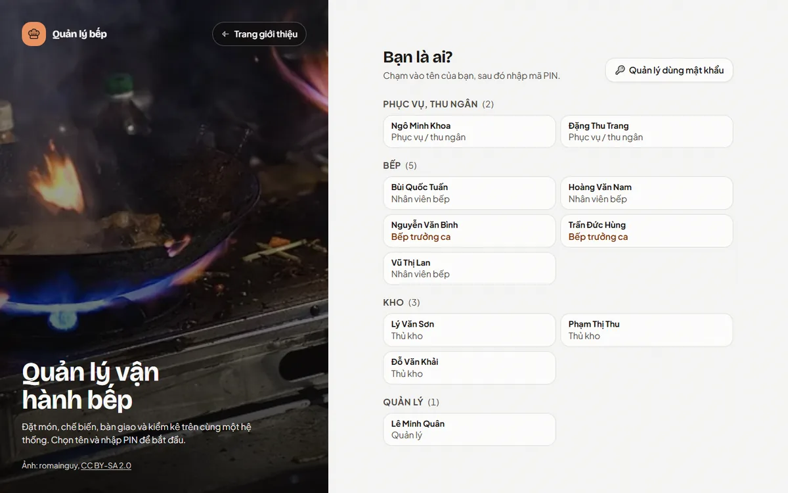
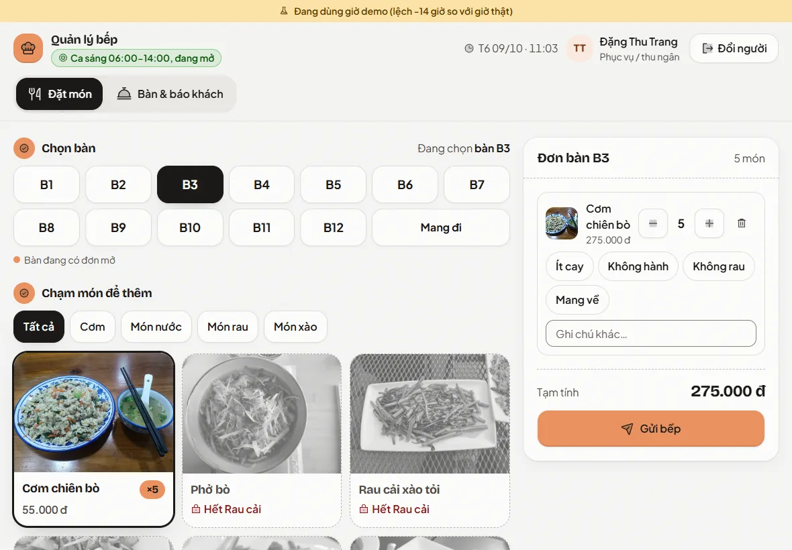
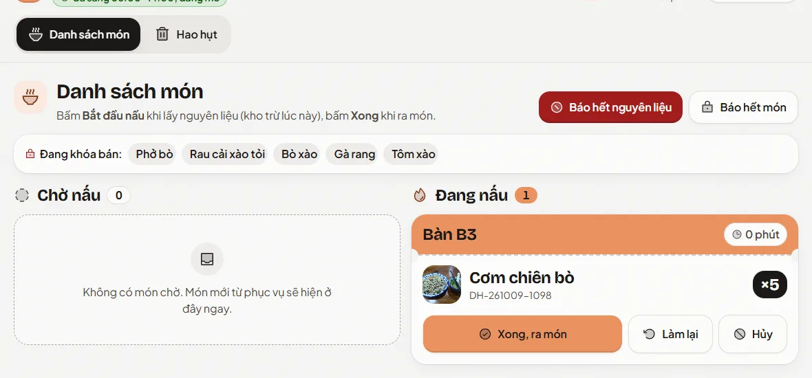
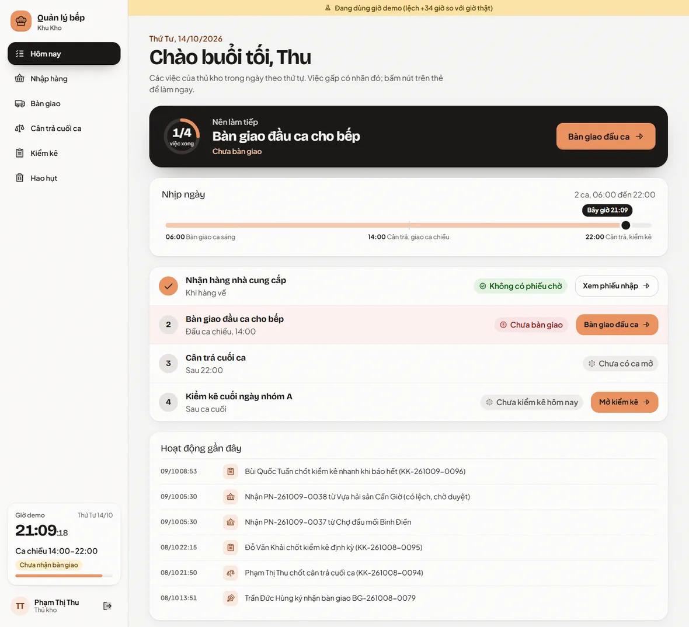
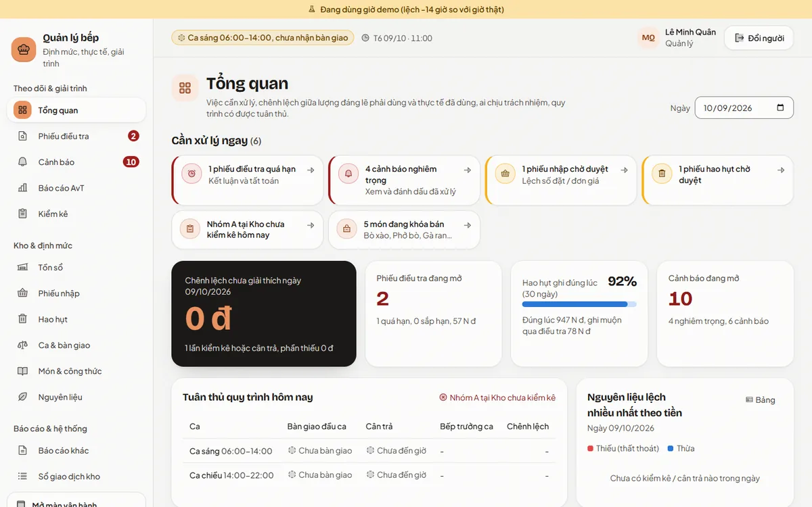

# Quản lý vận hành bếp

Hệ thống giúp nhà hàng **biết chính xác nguyên liệu đi đâu**. Hệ thống so lượng nguyên liệu *đáng lẽ phải dùng* theo số món đã bán với lượng *thực tế đã dùng* (phương pháp AvT, actual vs. theoretical). Khi hai con số lệch nhau, hệ thống chỉ ra lệch bao nhiêu gram, bao nhiêu tiền, trong ca nào, ai chịu trách nhiệm, và buộc quản lý giải trình.

Đồ án xây theo bản mô tả "Hệ thống quản lý vận hành bếp v1.5". Một web app dùng chung cho 4 vai trò: phục vụ, bếp, thủ kho (máy tính bảng) và quản lý (máy tính).



**Mục lục:** [Vấn đề](#hệ-thống-giải-quyết-vấn-đề-gì) · [Vai trò](#ai-dùng-dùng-để-làm-gì) · [Chạy dự án](#chạy-dự-án-bằng-docker-khuyên-dùng) · [Sự cố thường gặp](#sự-cố-thường-gặp) · [Phát triển](#chạy-khi-phát-triển) · [Kiểm thử](#kiểm-thử) · [Cấu trúc](#cấu-trúc-thư-mục)

## Hệ thống giải quyết vấn đề gì?

Ví dụ: bếp nhận **1 kg thịt bò**. Mỗi bát bò xào dùng 20 g, nên 1 kg làm được khoảng **50 bát**.

- Bán 49 hay 51 bát là sai số cân bình thường, hệ thống bỏ qua.
- Mới bán **5 bát** mà bếp báo "hết bò" là có vấn đề. Theo lý thuyết chỉ dùng 100 g, còn 900 g (khoảng 225.000 đ) không rõ đi đâu.

Không thể hỏi bếp "còn bao nhiêu" rồi tin con số đó. Vì vậy hệ thống lấy **số liệu thực tế độc lập với lời khai của bếp**:

| Cơ chế | Cách làm |
|---|---|
| Bàn giao có ký nhận | Thủ kho cân xuất, bếp trưởng **tự cân lại** (không thấy số của thủ kho) rồi ký bằng mã PIN. Lệch quá 5 g thì không ký được. |
| Trừ kho tự động | Món chuyển sang "đang nấu" là hệ thống trừ nguyên liệu theo công thức đang hiệu lực. |
| Cân trả và kiểm kê "mù" | Người cân, người đếm không được thấy tồn trên sổ, nên không thể "đếm cho khớp". |
| Ngưỡng hai tầng | Lệch nhỏ chỉ ghi nhận. Lệch lớn tự mở **phiếu điều tra** gắn với ca và bếp trưởng đã ký. |
| Giải trình | Hệ thống gợi ý nguyên nhân kèm bằng chứng (nhập sai, hao hụt chưa ghi, công thức sai, thất thoát…). Quản lý phân bổ nguyên nhân rồi kết luận, sổ kho được tất toán đúng loại. |
| Không sửa được dấu vết | Sổ giao dịch kho và nhật ký thao tác **chỉ được ghi thêm**, cơ sở dữ liệu chặn mọi lệnh sửa và xóa. |

## Ai dùng, dùng để làm gì?

| Vai trò | Thiết bị | Việc chính |
|---|---|---|
| **Phục vụ** | Máy tính bảng | Chọn bàn, chọn món gửi bếp. Có chuông và thông báo khi bếp nấu xong, bấm "Đã bưng" khi mang món ra bàn. Nhận báo khi món hết nguyên liệu để đổi món hoặc hủy. Giao diện mặc định sáng, có nút Sáng / Tối / Tự động (tối từ 18 giờ đến 6 giờ), lưu theo máy. |
| **Nhân viên bếp** | Máy tính bảng | Bảng 3 cột Chờ nấu / Đang nấu / Vừa ra món: bấm "Bắt đầu nấu" (kho trừ lúc này), "Xong, ra món". Ghi hao hụt, báo hết nguyên liệu hoặc hết món. |
| **Bếp trưởng ca** | Máy tính bảng | Như nhân viên bếp, thêm: cân lại và ký nhận bàn giao, duyệt hao hụt, xác nhận bằng PIN khi hủy hoặc làm lại món đang nấu, mở bán lại món bị khóa. |
| **Thủ kho** | Máy tính bảng | Màn "Việc hôm nay": nhập hàng, bàn giao đầu ca và bổ sung, cân trả cuối ca, kiểm kê. |
| **Quản lý** | Máy tính | Tổng quan, phiếu điều tra, cảnh báo, báo cáo AvT (xuất Excel), kiểm kê đột xuất, món và công thức, ngưỡng, người dùng, nhật ký, đồng hồ demo. Tìm nhanh mọi màn bằng Ctrl K. |

| Phục vụ: đặt món | Bếp: phiếu món |
|---|---|
|  |  |

| Thủ kho: việc hôm nay | Quản lý: tổng quan |
|---|---|
|  |  |

## Chạy dự án bằng Docker (khuyên dùng)

Cách này không cần cài Python, Node.js hay PostgreSQL: mọi thứ chạy trong Docker.

### Bước 1. Cài phần mềm

- [Docker Desktop](https://www.docker.com/products/docker-desktop/) cho Windows / macOS, hoặc Docker Engine và Docker Compose cho Linux.
- [Git](https://git-scm.com/).

Mở Docker Desktop và đợi biểu tượng báo "Engine running" rồi mới làm tiếp.

### Bước 2. Tải code

```bash
git clone https://github.com/congngoc308/project.git
cd project
```

### Bước 3. Khởi động

```bash
docker compose up -d --build
```

Lần đầu mất khoảng 3 đến 5 phút để tải và build. Lệnh này chạy 4 dịch vụ:

| Dịch vụ | Địa chỉ | Ghi chú |
|---|---|---|
| `web` | http://localhost:5190 | Giao diện |
| `api` | http://localhost:8010/docs | API (FastAPI). Tự tạo và cập nhật bảng (Alembic) mỗi khi khởi động |
| `db` | `localhost:5450` | PostgreSQL chính (user / mật khẩu: `qlb` / `qlb`) |
| `db-test` | `localhost:5451` | PostgreSQL riêng cho kiểm thử |

Kiểm tra cả 4 dịch vụ đã chạy:

```bash
docker compose ps
```

Cột `STATUS` phải là `Up` (riêng `db` có thêm `healthy`). Nếu `api` không lên, xem log bằng `docker compose logs api`.

### Bước 4. Nạp dữ liệu mẫu

```bash
docker compose exec api python -m seed.demo
```

Lệnh này **xóa sạch dữ liệu cũ** rồi sinh 30 ngày lịch sử: món, công thức, đơn hàng, bàn giao, kiểm kê, và vài vụ thất thoát được dàn dựng sẵn để thấy hệ thống phát hiện. Mất khoảng 3 phút. Cuối cùng nó đặt **đồng hồ demo** về 06:20 hôm nay (ca sáng, chưa nhận bàn giao).

### Bước 5. Mở và đăng nhập

Vào http://localhost:5190, chạm vào tên rồi nhập mã PIN **00000**. Mọi tài khoản demo dùng chung PIN này, gõ đủ 5 số là tự vào.

| Vai trò | Người | Đăng nhập |
|---|---|---|
| Quản lý | Lê Minh Quân | `quanly` / `quanly123` (nút "Quản lý dùng mật khẩu") hoặc PIN `00000` |
| Thủ kho | Phạm Thị Thu, Đỗ Văn Khải, Lý Văn Sơn | PIN `00000` |
| Bếp trưởng ca | Nguyễn Văn Bình, Trần Đức Hùng | PIN `00000` |
| Nhân viên bếp | Hoàng Văn Nam, Vũ Thị Lan, Bùi Quốc Tuấn | PIN `00000` |
| Phục vụ | Đặng Thu Trang, Ngô Minh Khoa | PIN `00000` |

- Trang giới thiệu hệ thống (không cần đăng nhập): http://localhost:5190/gioi-thieu.
- Muốn đổi người thì bấm **Đổi người**.
- Nên mở hai cửa sổ trình duyệt: một cửa sổ nhỏ (khoảng 1024×768) đóng vai máy tính bảng cho phục vụ, bếp, thủ kho; một cửa sổ lớn cho quản lý. Giao diện tự co giãn theo bề rộng cửa sổ.

### Bước 6. Thử kịch bản "1 kg bò, mới 5 bát đã hết"

Làm theo từng bước trong [docs/DEMO.md](docs/DEMO.md):

1. Thủ kho nhập 1 kg bò.
2. Thủ kho bàn giao bò cho bếp, bếp trưởng cân lại và ký PIN.
3. Phục vụ gọi 5 bát bò xào, bếp nấu.
4. Thủ kho cân trả cuối ca được 0 g.
5. Quản lý thấy phiếu điều tra: thiếu **900 g ≈ 225.000 đ**, gắn với bếp trưởng ca đó.

Màn **Đồng hồ demo** (menu quản lý) dùng để tua giờ: tới cuối ca, +48 giờ để phiếu quá hạn…

### Lệnh thường dùng

| Việc | Lệnh |
|---|---|
| Dừng, giữ dữ liệu | `docker compose stop` |
| Chạy lại | `docker compose start` |
| Build lại sau khi sửa code | `docker compose up -d --build` (chỉ web: `docker compose up -d --build web`) |
| Nạp lại dữ liệu mẫu từ đầu | `docker compose exec api python -m seed.demo` |
| Chỉ đặt lại PIN demo về `00000` | `docker compose exec api python -m seed.reset_pins` |
| Xem log | `docker compose logs -f api` (hoặc `web`, `db`) |
| Xóa hẳn container và dữ liệu | `docker compose down -v` |

Bản Docker chạy web từ bản build, nên **sửa code xong phải build lại** mới thấy thay đổi. Khi phát triển thường xuyên, nên dùng cách ở mục [Chạy khi phát triển](#chạy-khi-phát-triển) để có tự tải lại.

## Sự cố thường gặp

| Hiện tượng | Cách xử lý |
|---|---|
| `port is already allocated` khi khởi động | Cổng 5190, 8010, 5450 hoặc 5451 đang bị chương trình khác dùng. Sửa số bên trái trong phần `ports` của `docker-compose.yml` (ví dụ `"5191:5190"`), rồi mở địa chỉ theo cổng mới. |
| Mở web thấy trang trắng hoặc lỗi kết nối | Đợi `api` khởi động xong (`docker compose ps`), rồi tải lại trang. |
| Màn đăng nhập không có ai trong danh sách | Chưa nạp dữ liệu mẫu: chạy bước 4. |
| Nhập PIN `00000` bị báo sai | Dữ liệu được tạo từ bản cũ với PIN khác. Chạy `docker compose exec api python -m seed.reset_pins`. |
| "Nhập sai PIN quá 5 lần" | Tài khoản bị khóa PIN 5 phút. Đợi hết thời gian hoặc chạy lệnh đặt lại PIN ở trên. |
| Món hiện "Hết …" mà không mở bán lại được | Bếp đã báo hết nguyên liệu. Cần có bàn giao bổ sung, phiếu nhập hoặc kiểm kê đột xuất xác nhận đã có lại hàng, rồi bếp trưởng hoặc quản lý mới bấm "Bán lại" được. |
| Giờ trên app khác giờ thật | Đang ở chế độ demo với đồng hồ đã tua. Vào **Đồng hồ demo** và bấm "Về giờ thật". |

## Chạy khi phát triển

Cách này chạy api và web trực tiếp trên máy để code thay đổi là tự tải lại. Cơ sở dữ liệu vẫn chạy bằng Docker.

Cần cài: **Python 3.11+** và **Node.js 22** (Vite 8 yêu cầu Node 20.19+ hoặc 22.12+).

```bash
# Cơ sở dữ liệu
docker compose up -d db db-test

# Backend (cửa sổ dòng lệnh thứ nhất)
cd backend
python -m venv .venv
.venv/Scripts/pip install -r requirements.txt        # Linux / macOS: .venv/bin/pip
.venv/Scripts/alembic upgrade head
.venv/Scripts/python -m seed.demo
.venv/Scripts/uvicorn app.main:app --port 8010 --reload

# Frontend (cửa sổ dòng lệnh thứ hai)
cd frontend
npm install
npm run dev                                           # http://localhost:5190, /api chuyển sang :8010
```

Nếu đang chạy bản Docker thì dừng `api` và `web` trước (`docker compose stop api web`) để khỏi trùng cổng. Quy ước code và các bất biến phải giữ (sổ kho chỉ ghi thêm, kiểm kê mù, giờ nghiệp vụ…) ghi trong [CLAUDE.md](CLAUDE.md).

## Kiểm thử

```bash
docker compose up -d db-test                          # cơ sở dữ liệu kiểm thử, cổng 5451
cd backend && .venv/Scripts/python -m pytest
cd frontend && npx tsc -b && npm run build
```

Mỗi tiêu chí nghiệm thu (AC) trong bản mô tả có test tương ứng:

| Tiêu chí | File test |
|---|---|
| AC-01 → AC-05: đơn món, trừ kho theo công thức, hủy, hao hụt sơ chế | `backend/tests/test_ac_theoretical.py` |
| AC-06 → AC-11: nhập hàng, bàn giao, cân trả mù, ngưỡng, kịch bản 1 kg bò | `backend/tests/test_ac_actual.py` |
| AC-12 → AC-18: báo hết, tất toán, xu hướng, báo cáo AvT, phân quyền, nhật ký | `backend/tests/test_ac_control.py` |
| Sổ kho chỉ ghi thêm, ghi đồng thời không sai tồn | `backend/tests/test_ledger.py` |
| Bước "Đã bưng": chỉ món đã xong, không bưng hai lần, không tác động kho | `backend/tests/test_served.py` |

## Công nghệ

| Phần | Công nghệ |
|---|---|
| Giao diện | React 19, Vite, TypeScript, Tailwind CSS v4, shadcn/ui, TanStack Query / Table, icon Phosphor |
| Máy chủ | Python, FastAPI, SQLAlchemy 2, Alembic, pytest |
| Cơ sở dữ liệu | PostgreSQL 16 |
| Cập nhật tức thời | Server-Sent Events: món mới hiện ngay ở bếp, món xong và báo hết hiện ngay ở phục vụ |

## Cấu trúc thư mục

```
backend/
  app/
    services/ledger.py         sổ giao dịch kho, nơi duy nhất ghi biến động tồn
    services/variance.py       tính chênh lệch, ngưỡng hai tầng, cảnh báo xu hướng
    services/investigations.py gợi ý nguyên nhân, kết luận và tất toán phiếu điều tra
    services/...               đơn món, bàn giao, kiểm kê, nhập hàng, hao hụt, báo cáo
    api/                       các API
    clock.py                   đồng hồ nghiệp vụ (tua được ở chế độ demo)
  alembic/                     tạo bảng, chặn sửa / xóa sổ kho, các lần đổi cấu trúc
  seed/                        dữ liệu mẫu 30 ngày (demo.py), đặt lại PIN (reset_pins.py)
  tests/                       kiểm thử theo tiêu chí nghiệm thu
frontend/
  src/layouts/                 khung máy tính bảng (phục vụ, bếp, thủ kho) và khung quản lý
  src/pages/ops/               màn phục vụ, bếp
  src/pages/store/             màn thủ kho
  src/pages/manager/           màn quản lý
  public/img/                  ảnh món và ảnh bếp
docs/
  DEMO.md                      kịch bản trình bày từng bước
  SO_DO_HE_THONG.md            sơ đồ phân tích thiết kế (use case, DFD, ERD, luồng, trạng thái)
  GIAO_DIEN.md                 thiết kế giao diện, bảng màu, nguồn và giấy phép ảnh
```

## Giả định đang dùng

- 2 ca mỗi ngày: ca sáng 06:00-14:00, ca chiều 14:00-22:00.
- **Ngưỡng** (sửa được ở màn Cài đặt ngưỡng):
  - nhóm A (hàng tươi): lệch > 2,5% và > 25 g thì cảnh báo; > 5% và > 50 g thì bắt buộc giải trình;
  - nhóm C (gia vị, hàng khô): 10% và 20%.
- **Mốc khác:** hạn xử lý phiếu điều tra 48 giờ, dung sai cân khi bàn giao 5 g, cảnh báo xu hướng sau 3 kỳ lệch cùng chiều.
- Chênh lệch quy ra tiền theo đơn giá nhập gần nhất.
- Mã PIN cố định 5 chữ số.
- Bước "Đã bưng" của phục vụ là phần mở rộng so với bản mô tả v1.5. Các mục "Nên có" và "Để sau" của bản mô tả chưa làm.

## Lưu ý khi triển khai thật

Mật khẩu cơ sở dữ liệu, `SECRET_KEY` trong `docker-compose.yml` và mã PIN `00000` chỉ dùng cho demo. Hãy đổi chúng, đặt PIN riêng cho từng người ở màn **Người dùng**, và tắt `DEMO_MODE` (chế độ có đồng hồ tua được) trước khi dùng thật.

## Nguồn ảnh

Ảnh món ăn và ảnh bếp lấy từ Wikimedia Commons, theo giấy phép CC0, CC BY và CC BY-SA. Tác giả và link gốc từng ảnh ghi trong [docs/GIAO_DIEN.md](docs/GIAO_DIEN.md#ảnh-thật).
