# Sơ đồ phân tích thiết kế — Hệ thống quản lý vận hành bếp

Vẽ theo đúng code trong repo. Mở bằng GitHub hoặc VS Code (Markdown Preview Mermaid) để xem sơ đồ.

## Phân tích

### 01. Vòng kiểm soát Định mức – Thực tế – Giải trình

Đây là xương sống của đề tài. Bên trái tạo ra số lý thuyết (đáng lẽ phải dùng), nhánh giữa tạo ra số thực tế do người không dùng nguyên liệu cân đếm, rồi hệ thống so hai số với ngưỡng. Lệch lớn thì buộc quản lý giải trình.

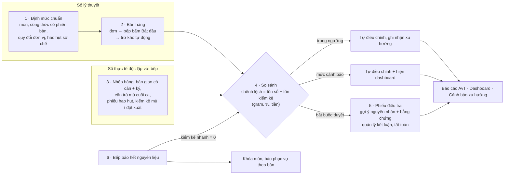

*Cài đặt: services/orders.py (lý thuyết) · services/handover.py, counts.py, receiving.py, waste.py (thực tế) · services/variance.py (so sánh) · services/investigations.py (giải trình)*

### 02. Use case theo vai trò

Năm vai trò, mỗi người có thể kiêm nhiều vai trò. Đường nét đứt là việc cần người khác xác nhận: đó là chỗ thể hiện phân tách nhiệm vụ.

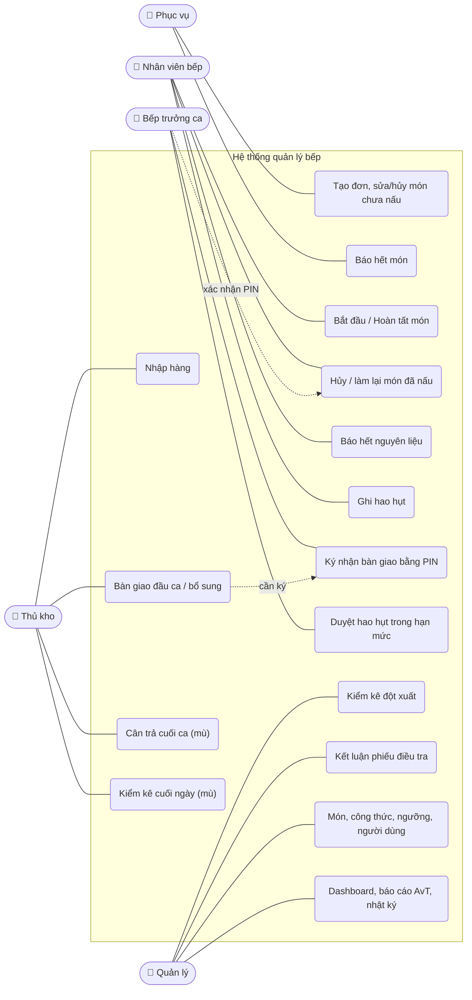

### 03. Sơ đồ phân rã chức năng (BFD)

Bảy nhóm chức năng của MVP. Nhóm 4 là trọng tâm của đề tài; các nhóm còn lại tồn tại để cung cấp dữ liệu đúng cho nó.

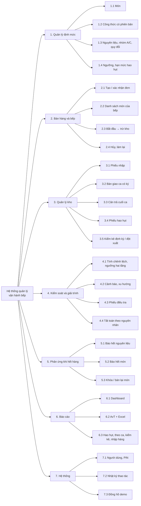

### 04. DFD mức ngữ cảnh

Hệ thống là một khối duy nhất; các mũi tên là dữ liệu đi vào và đi ra với từng tác nhân.

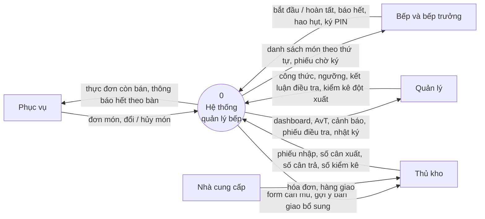

### 05. DFD mức 0

Khối hệ thống được tách thành sáu tiến trình. Kho dữ liệu trung tâm là D3 Sổ giao dịch kho: mọi biến động tồn đều ghi vào đây, chỉ ghi thêm, không sửa.

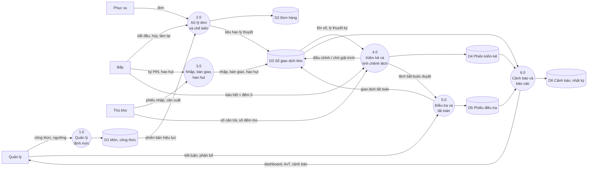

## Thiết kế

### 06. Kiến trúc hệ thống

Một web app React có hai bố cục: máy tính bảng (nút lớn) cho phục vụ, bếp, kho và quản lý (có sidebar). Backend FastAPI chia theo service; mỗi thao tác chạy trong một transaction Postgres. Sự kiện (đơn mới, hết hàng, cảnh báo) được đẩy về trình duyệt bằng SSE sau khi commit.

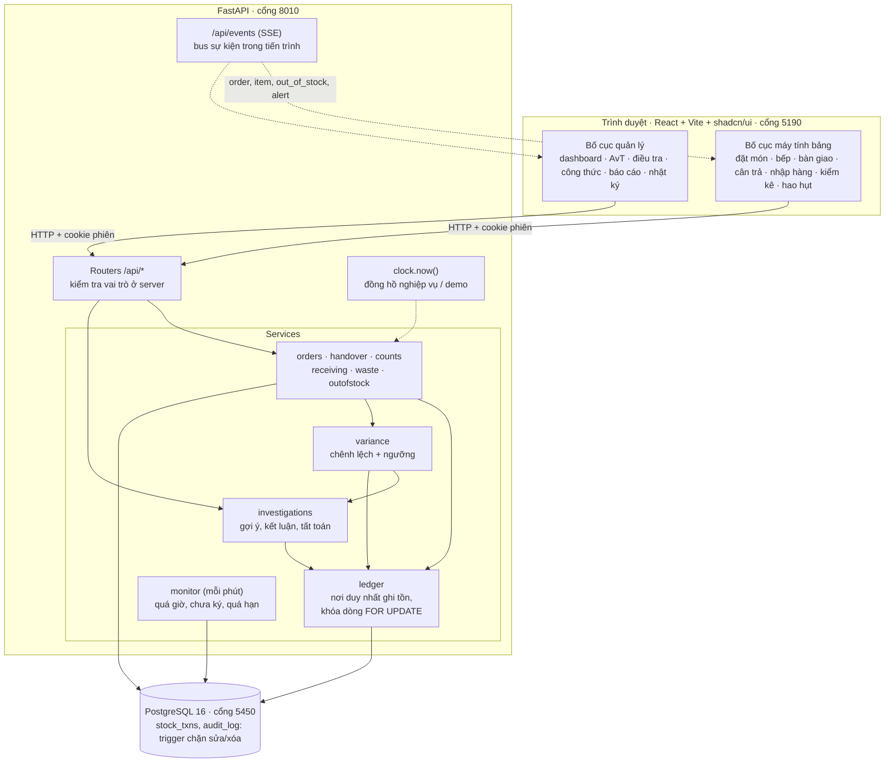

*Cài đặt: backend/app/main.py · app/events.py · app/clock.py · frontend/src/layouts/*

### 07. ERD — danh mục, ca và bán hàng

Mỗi món có nhiều phiên bản công thức theo ngày hiệu lực. Khi món chuyển Đang chế biến, order_items lưu lại recipe_version_id đang hiệu lực, nên sửa công thức sau đó không làm đổi số liệu cũ.

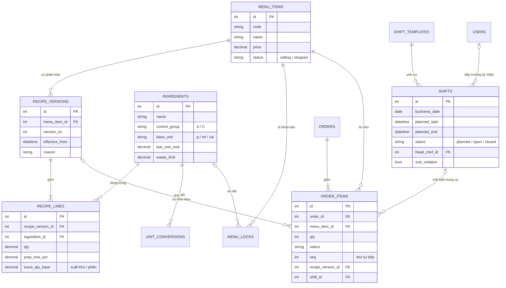

### 08. ERD — kho, kiểm kê và giải trình

Mọi chứng từ (phiếu nhập, bàn giao, hao hụt, dòng kiểm kê, phiếu điều tra) đều sinh ra các dòng STOCK_TXNS bất biến, trỏ ngược về chứng từ qua source_type/source_id. STOCK_BALANCES chỉ là bản cache của SUM, khóa dòng khi ghi để chống ghi đồng thời.

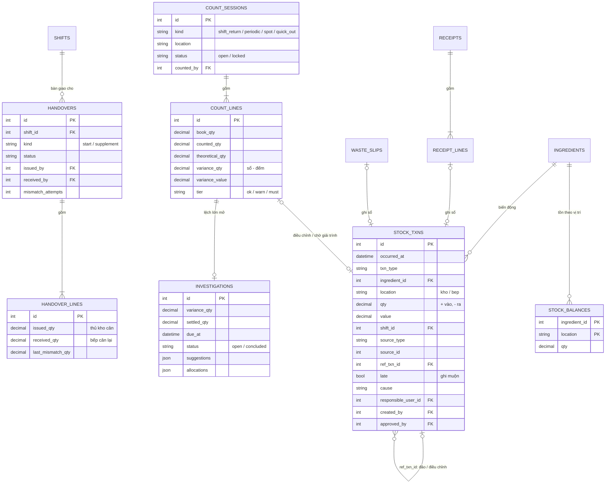

*Bảng phụ: alerts, audit_log (chỉ ghi thêm), settings, system_clock, users. Cài đặt: backend/app/models/*

### 09. Phân quyền và phân tách nhiệm vụ

Nguyên tắc: người dùng nguyên liệu không tự xác nhận số tồn của nguyên liệu đó. Quyền được kiểm tra ở server, không chỉ ẩn nút.

| Vai trò | Được làm | Bị chặn |
|---|---|---|
| Phục vụ | Tạo đơn; sửa, hủy món chưa nấu; báo hết món | Hủy món đã bắt đầu chế biến |
| Nhân viên bếp | Bắt đầu / hoàn tất; báo hỏng, làm lại (cần PIN bếp trưởng); báo hết nguyên liệu; ghi hao hụt | Xem tồn sổ; nhập số kiểm kê hay cân trả |
| Bếp trưởng ca | Ký nhận bàn giao; xác nhận hủy / làm lại; duyệt hao hụt trong hạn mức (không phải phiếu của mình); bán lại món | Nhập số cân trả; kết luận phiếu điều tra của ca mình đã ký |
| Thủ kho | Nhập hàng; bàn giao; cân trả; kiểm kê mù; ghi hao hụt kho | Xem tồn sổ (kể cả Kho); duyệt kiểm kê của chính mình; duyệt phiếu nhập mình nhận |
| Quản lý | Mọi danh mục, ngưỡng; kiểm kê đột xuất; kết luận điều tra; dashboard, báo cáo, nhật ký | Sửa / xóa nhật ký và sổ giao dịch (DB chặn); kết luận phiếu của ca mình đã ký nhận |

*Kiêm nhiệm được phép nhưng ca bị đánh dấu sod_violation. Cài đặt: auth/security.py (require), counts._check_counter, investigations.involved_users*

## Luồng hoạt động

### 10. Một ca làm việc từ đầu đến cuối (kịch bản 1 kg bò)

Kỳ đo của nhóm A là một ca: từ lúc bếp trưởng ký nhận đến lúc thủ kho cân trả. Nhờ vậy chênh lệch gắn được với người đã ký.

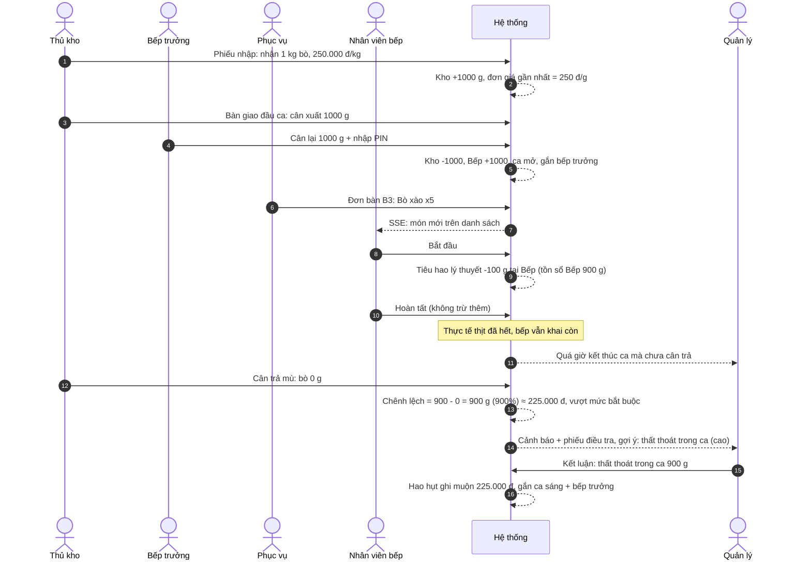

### 11. Ký nhận bàn giao bằng PIN

Bếp trưởng cân lại mà không thấy số thủ kho đã cân. Lệch quá dung sai (5 g) thì chưa chuyển tồn; lần ký lỗi vẫn được lưu làm bằng chứng cho phiếu điều tra sau này.

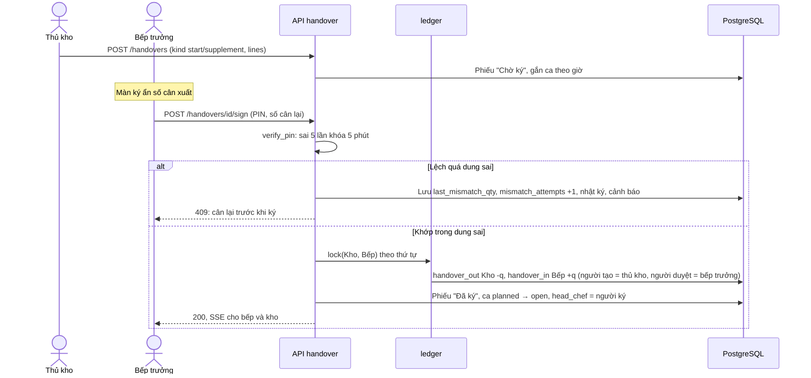

*Cài đặt: services/handover.py · auth/security.verify_pin*

### 12. Bắt đầu chế biến → trừ kho theo công thức

Nguyên liệu rời tồn lúc món chuyển Đang chế biến, không chờ Hoàn tất. Nhóm A trừ ở Bếp, nhóm C trừ ở Kho. Hủy hoặc làm lại sau khi đã bắt đầu thì đảo tiêu hao và ghi hao hụt.

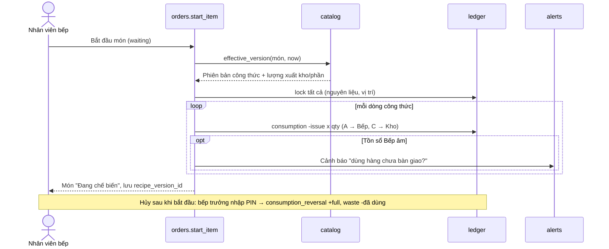

*Cài đặt: services/orders.py (start_item, cancel_item, remake_item)*

### 13. Tính chênh lệch và ngưỡng hai tầng

Mọi lần chốt số thật (cân trả, kiểm kê định kỳ, đột xuất, báo hết) đi qua cùng một hàm. Chỉ coi là vượt khi vượt cả % lẫn mức tuyệt đối; kỳ không bán món nào thì chỉ xét tuyệt đối.

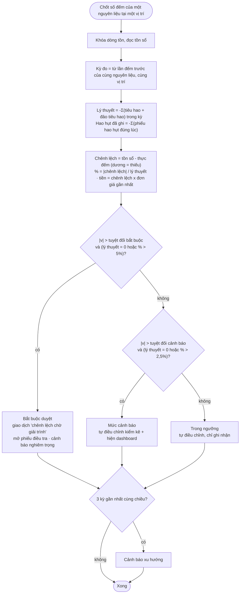

*Ví dụ nhóm A (thịt bò): 49 bát/kg → +20 g = 2,0% → trong ngưỡng. 5 bát/kg → +900 g = 900% → bắt buộc duyệt. Cài đặt: services/variance.py (evaluate, classify, check_trend)*

### 14. Bếp báo hết nguyên liệu

"Hết" được coi là một lần kiểm kê nhanh với số đếm = 0, nên chênh lệch được tính ngay. Bếp không nhận lại tồn sổ hay chênh lệch.

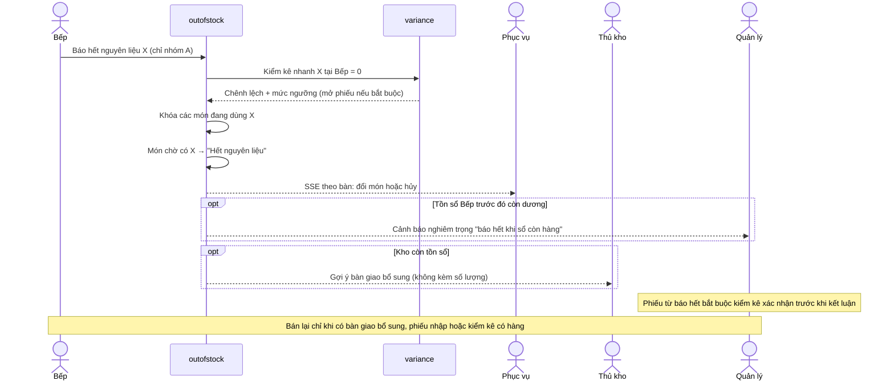

*Cài đặt: services/outofstock.py · catalog.resell*

### 15. Phiếu điều tra và tất toán theo nguyên nhân

Tất toán là phân loại lại, tồn không đổi: mỗi phần phân bổ ghi một giao dịch đảo khoản chờ giải trình (+q) và một giao dịch theo đúng nguyên nhân (-q). Nhờ vậy báo cáo hao hụt không lẫn lỗi nhập hàng.

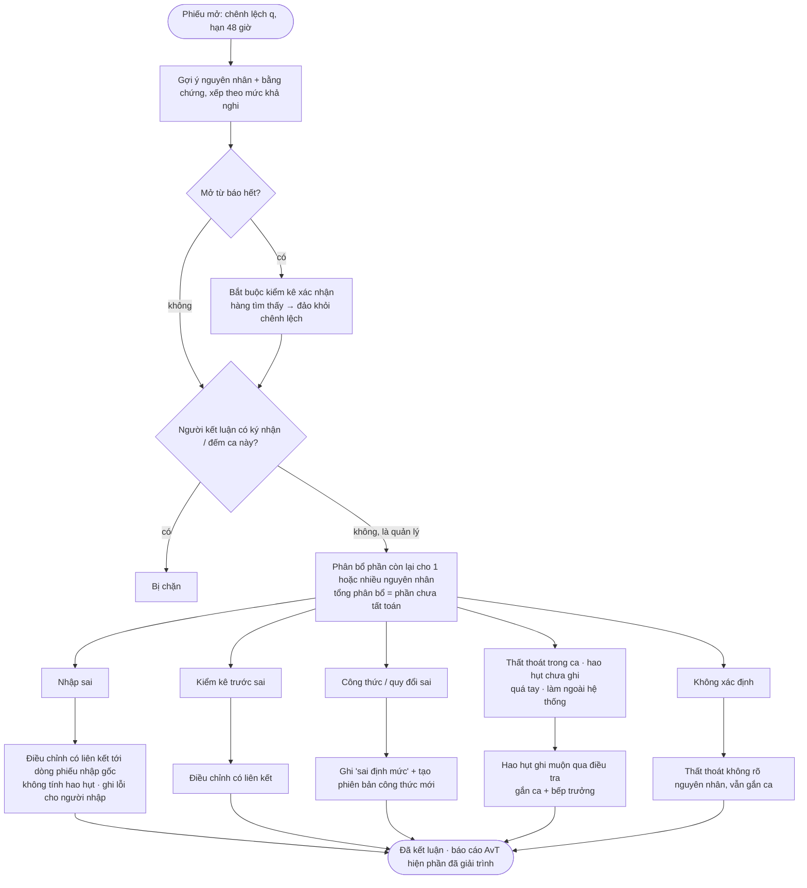

*Cài đặt: services/investigations.py (suggest, verify_false_out, conclude)*

## Vòng đời

### 16. Món trong đơn

Ranh giới quan trọng là Bắt đầu. Trước ranh giới đó, hủy món không tác động kho. Sau đó, hủy cần bếp trưởng xác nhận và phần đã dùng thành hao hụt.

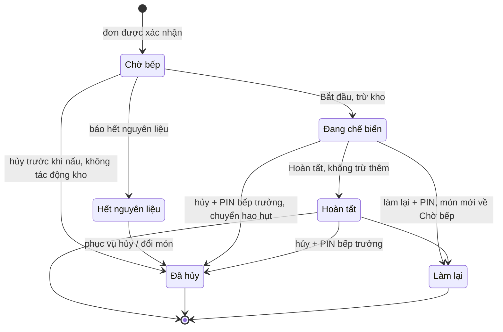

### 17. Ca làm việc (mô hình kết hợp)

Giờ dự kiến lấy từ mẫu ca, dùng để cảnh báo. Kỳ đo thật được mở và đóng bằng sự kiện (ký nhận, cân trả).

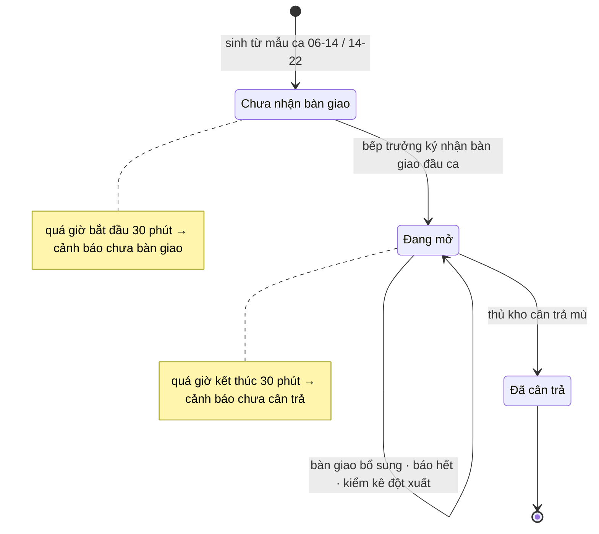

### 18. Chứng từ kho: bàn giao, phiếu nhập, phiếu hao hụt, phiên kiểm kê

Không chứng từ nào đã ghi sổ bị sửa. Muốn sửa sai thì tạo giao dịch hoặc phiên mới có liên kết tới bản gốc.

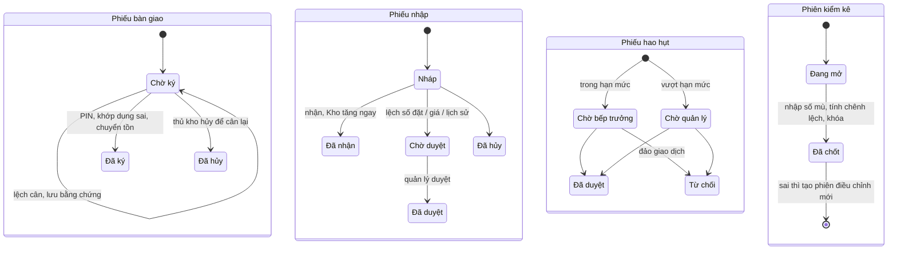

### 19. Phiếu điều tra

Phiếu chỉ đóng khi toàn bộ chênh lệch đã được phân bổ cho nguyên nhân.

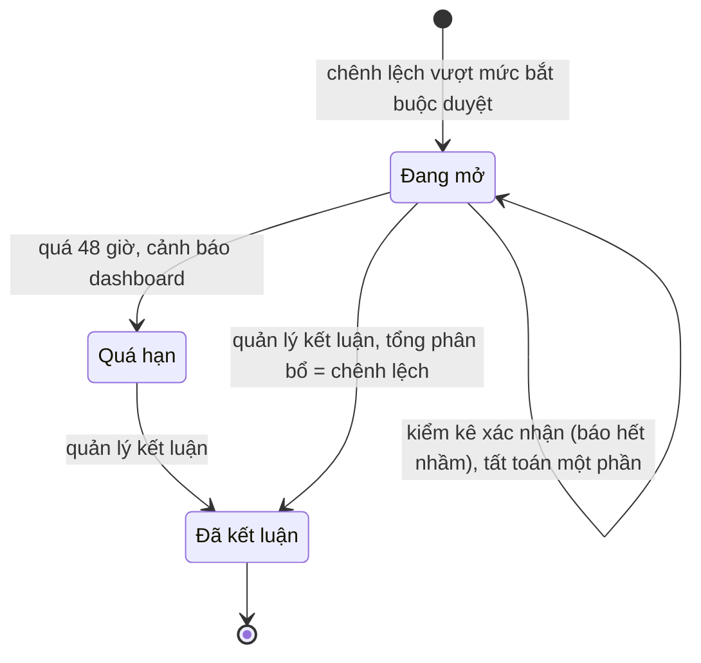
